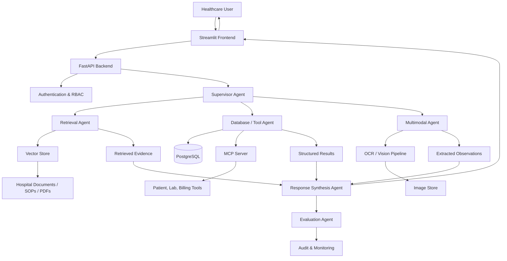
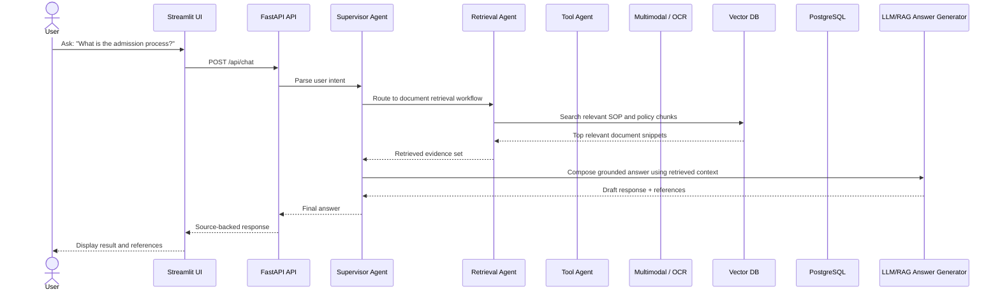
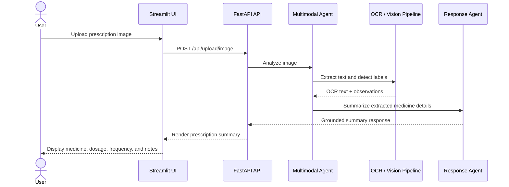
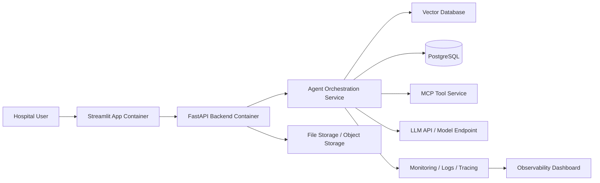

# MediAssist AI - Architecture Breakdown Document

# MediAssist AI
## Enterprise Healthcare Agentic AI Copilot
### System Architecture, Agent Workflow, Data Flow, and Deployment Design

| Field | Value |
|---|---|
| Project Name | MediAssist AI |
| Document Type | Architecture Breakdown Document |
| Version | 1.0 |
| Date | 2026-10-23 |
| Prepared For | Healthcare enterprise AI implementation team |
| Status | Draft architectural design |
| Scope | Prototype-to-production-ready enterprise healthcare AI system |

---

## 1. Executive Summary

MediAssist AI is an enterprise healthcare copilot designed to unify fragmented healthcare information across SOPs, operational manuals, compliance documents, PDFs, discharge summaries, structured patient data, and multimodal clinical inputs. The architecture is built to support a knowledge-centric, human-safe, enterprise-grade AI system that helps hospital staff answer operational and clinical queries with source-backed responses.

The platform follows a layered, modular enterprise AI design:

- Frontend for user interaction
- API gateway and backend services
- Agent orchestration layer for planning, routing, and decision-making
- RAG and vector retrieval layer for enterprise knowledge search
- Tool integration layer for PostgreSQL/MCP operations
- Multimodal processing layer for OCR and image analysis
- Data storage and vector database layer
- Monitoring, evaluation, and deployment layer

The core design principle is grounded intelligence: every answer must be anchored in trusted documents, structured records, or validated tool outputs. This is especially important in healthcare, where hallucinated recommendations and unsafe response generation can have serious consequences.

The system is structured to support:

- healthcare knowledge retrieval
- clinical and operational conversations
- multimodal document intake
- structured database access
- role-based usage control
- observability and evaluation
- cloud deployment readiness

---

## 2. Goals and Design Principles

### 2.1 Business Goals

- unify fragmented hospital data into one AI-powered conversational interface
- reduce time spent searching for SOPs, operational guidance, and patient context
- provide trusted, evidence-backed answers to healthcare staff
- support upload and analysis of PDFs, DOCX, TXT, and medical images
- integrate structured hospital systems using secure tool interfaces
- provide enterprise-ready architecture that can scale for future deployments

### 2.2 Technical Design Principles

1. Modular decomposition
   - separate UI, orchestration, retrieval, tools, storage, and monitoring layers

2. Grounded responses only
   - rely on retrieved documents and tool results rather than free-form unsupported generation

3. Human-in-the-loop safety
   - preserve human oversight for clinician- and operations-critical tasks

4. Role-aware access
   - restrict information by user role and authorization

5. Extensible architecture
   - enable future integrations with EHRs, hospital systems, and governance tools

6. Observability and evaluation
   - support monitoring, logging, quality evaluation, and auditing

7. Deployment readiness
   - design for containerization, cloud hosting, and operational monitoring

---

## 3. System Overview

MediAssist AI is designed as a multi-layer healthcare AI platform with the following core characteristics:

- conversational interface for healthcare staff
- retrieval from unstructured hospital documents
- tool-based access to structured operational and patient data
- multimodal understanding of medical images and documents
- agent-based orchestration for delegating specialized workflows
- enterprise-ready cloud deployment and observability

### 3.1 High-Level Concept

The user interacts through a frontend application. Requests are routed to backend services and dispatched to one or more specialized AI components. These components may perform:

- semantic document retrieval
- message reasoning
- tool invocation for DB queries
- prescription or image extraction
- evaluation of response safety and source quality

The final answer is assembled using retrieved evidence and presented back to the user with references, confidence, and source metadata.

---

## 4. Functional Architecture

### 4.1 Layered Architecture

The system architecture is organized into these layers:

1. Presentation Layer
   - Streamlit web UI
   - login, dashboard, chat interface, upload panel, report view

2. API and Application Layer
   - FastAPI backend
   - authentication and session layer
   - file upload APIs
   - query orchestration APIs
   - health and monitoring API

3. Orchestration / Agent Layer
   - supervisor agent
   - retrieval agent
   - database/tool agent
   - multimodal agent
   - response synthesis agent
   - evaluation agent

4. Knowledge and Data Layer
   - vector database for embeddings
   - document store / file store
   - PostgreSQL for structured hospital data
   - metadata store for retrieval indexes and audit logs

5. Integration and External Layer
   - MCP server
   - DB connectors
   - document parser engines
   - LLM providers
   - cloud storage, monitoring, and deployment services

6. Observability and Governance Layer
   - logging
   - tracing
   - metrics
   - evaluation records
   - access audit trail

---

## 5. Component Breakdown

### 5.1 Presentation Layer

#### Streamlit Frontend

Responsibilities:

- user authentication UI
- chat interface for natural-language queries
- document upload interface
- image upload interface
- response presentation with source references
- role-appropriate dashboard views
- health or status indicators

Key features:

- simple, staff-friendly UX
- forms for upload and query
- action buttons for patient history, SOP lookup, and multimodal input
- result display with document source names and snippets

### 5.2 API Layer

#### FastAPI Backend

Responsibilities:

- expose REST endpoints for chat, upload, retrieval, and monitoring
- authenticate users and enforce RBAC
- route requests to relevant agents or tools
- handle file storage and metadata creation
- orchestrate retrieval workflows and tool calls
- return JSON responses to frontend

Key endpoints may include:

- POST /api/login
- POST /api/chat
- POST /api/upload/document
- POST /api/upload/image
- POST /api/retrieve
- GET /api/health
- GET /api/metrics
- GET /api/audit

### 5.3 Agent Orchestration Layer

This is the cognitive decision-making and routing layer. It coordinates specialized agents for different tasks.

#### 5.3.1 Supervisor Agent

Responsibilities:

- decide which workflow to invoke
- route user questions to retrieval, tool, or multimodal agents
- decide whether answer is grounded, needs follow-up, or needs escalation
- enforce guardrails and output constraints

Example decisions:

- FAQ/SOP question -> retrieval agent
- patient history query -> database tool agent + retrieval agent
- prescription upload -> OCR/multimodal agent
- unsupported request -> safe refusal or request clarification

#### 5.3.2 Retrieval Agent

Responsibilities:

- process natural-language query
- convert to embeddings or semantic query
- retrieve top-k relevant chunks from vector store
- rerank and filter context
- return the most relevant evidence set

This agent is central for enterprise RAG.

#### 5.3.3 Database / Tool Agent

Responsibilities:

- execute secure tool calls against PostgreSQL or MCP-based endpoints
- fetch patient history, billing history, lab results, or operational records
- validate tool permissions before execution
- summarize tool results and pass them to the response layer

Examples of tool functions:

- get_patient_history(patient_id)
- get_lab_results(patient_id)
- search_patients(search_term)
- get_payment_summary(patient_id)
- get_hospital_policy(topic)

#### 5.3.4 Multimodal Agent

Responsibilities:

- receive uploaded image or document
- run OCR or vision extraction
- detect critical fields such as medicines, dosage, frequency, and observations
- summarize medically relevant extracted content
- ensure output is grounded in the image and not unsupported claims

This agent is responsible for the “do not fabricate medical advice” principle.

#### 5.3.5 Response Synthesis Agent

Responsibilities:

- combine retrieved source context + tool results + user question
- generate final response in conversational format
- include source citations or references
- maintain answer safety and context clarity
- highlight uncertainty where needed

#### 5.3.6 Evaluation Agent

Responsibilities:

- score response quality, relevance, and safety
- validate that the answer is grounded in available evidence
- detect hallucination or unsupported recommendation generation
- log evaluation metrics for future tuning

This agent supports governance and long-term model quality improvement.

---

## 6. Data Architecture

### 6.1 Data Categories

The system manages several types of data:

1. Unstructured documents
   - PDFs, DOCX, TXT, SOPs, policy documents, discharge summaries

2. Structured data
   - patient records, lab data, claims/billing details, operational metadata

3. Multimodal inputs
   - images, prescriptions, medical scans

4. Metadata and indexes
   - chunk IDs, embedding vectors, references, timestamps, source metadata

5. Operational telemetry
   - logs, metrics, tool traces, evaluation results, audit events

### 6.2 Storage Design

#### Document Storage

- raw file store for user uploads
- structured storage with metadata like file_id, uploaded_by, timestamp, department, file_type

#### Vector Store

- stores chunked document embeddings for semantic retrieval
- supports top-k nearest-neighbor retrieval
- links each embedding to source document metadata and chunk IDs

#### Relational Database

- stores patient records, claims, operational logs, user roles, permissions, and metadata
- suitable for authentication, RBAC, and transactional structured queries

#### Audit/Telemetry Store

- logs query history, file processing steps, tool invocations, model responses, and evaluation scores

---

## 7. Data Flow Design

### 7.1 End-to-End System Data Flow

### 7.2 Query Flow for a Typical Chat Request

### 7.3 Prescription Upload Flow

---

## 8. Agent Workflow Design

### 8.1 Agent Workflow Model

The system uses a supervisor-led orchestration pattern. The supervisor decides which specialized agent should act and whether the task needs data retrieval, tool invocation, or multimodal processing.

### 8.2 Workflow Patterns

#### Pattern 1: Retrieval-first Q&A

- User enters natural-language question
- Supervisor routes to retrieval agent
- Retrieval agent fetches top-k evidence from vector store
- Final response is composed using evidence and source references

#### Pattern 2: Tool-enhanced Q&A

- User asks for patient history or billing data
- Supervisor routes to tool agent
- Tool agent validates access and queries PostgreSQL / MCP tool layer
- Structured results are merged with document evidence

#### Pattern 3: Multimodal understanding

- User uploads a prescription or medical image
- Multimodal agent performs OCR and extraction
- Result is summarized and presented without unsupported recommendations

#### Pattern 4: Safety and compliance routing

- User asks high-risk or ambiguous medical question
- Supervisor triggers guarded response flow
- System refuses unsupported advice and requests human review when necessary

---

## 9. Deployment Architecture

### 9.1 Target Deployment Topology

This architecture is designed for cloud deployment with containerized services and enterprise-style hosting. A typical Azure-based topology could include:

### 9.2 Deployment Components

#### Frontend Container

- Streamlit application
- user-facing chat and upload UI
- deployed as a containerized web service

#### Backend Container

- FastAPI APIs
- authentication and authorization logic
- orchestration service
- retrieval / tool orchestration logic

#### LLM / AI Layer

- hosted through OpenAI, Azure OpenAI, or compatible model endpoint
- handles reasoning, answer synthesis, and guardrail checks

#### Vector DB Service

- semantic document retrieval engine
- stores document chunks and embeddings

#### PostgreSQL Database

- stores hospital structured data and metadata
- supports patient, billing, and operational access patterns

#### MCP Layer

- abstracts structured system access into tool calls
- presents uniform interface for patient and operational queries

#### Monitoring Stack

- logs, tracing, metrics dashboard
- operational observability for all microservices

### 9.3 Containerization and Infrastructure

Recommended deployment pattern:

- Docker containers for each service
- Docker Compose for local environment
- Azure Container Apps / AKS / App Service for production hosting
- object storage for uploaded documents and image artifacts
- environment variables for secrets and API keys

---

## 10. Security Architecture

### 10.1 Authentication

- user authentication via secure login service
- session management for authenticated access
- support for enterprise identity integration in future deployments

### 10.2 Authorization

- role-based access control (RBAC)
- department-based restrictions for front desk, insurance, doctor, admin, and compliance roles
- secure tool invocation gating by permission scope

### 10.3 Data Protection

- encrypted transport for all API and frontend traffic
- encrypted storage for sensitive records where appropriate
- least-privilege access to data sources and tools
- restricted access to patient records, billing, and compliance artifacts

### 10.4 Audit and Governance

- log document uploads and queries
- log tool invocations and result retrieval
- track answer generation and evidence usage
- preserve governance trail for compliance review

---

## 11. Observability and Monitoring

Observability is critical for enterprise AI systems. The architecture includes:

- structured application logs
- response time metrics
- retrieval latency metrics
- database query latency
- tool execution success/failure metrics
- error rate by workflow type
- model quality evaluation metrics

### Monitoring Components

- backend metrics dashboard
- application health checks
- audit logs and structured event tracking
- evaluation data for RAG quality and safety monitoring

---

## 12. Scalability and Performance Design

### 12.1 Scalability

The platform is designed to scale in three dimensions:

1. user scale
   - more hospital staff and concurrent sessions

2. document scale
   - more PDF, SOP, and compliance documents

3. workflow scale
   - more specialized agents, tools, and integrations

### 12.2 Performance Considerations

- chunk documents efficiently for retrieval
- use vector search optimized with appropriate indexing
- limit top-k context size to maintain answer quality and latency
- parallelize non-dependent tasks where feasible
- maintain caching for common lookup operations

### 12.3 Resilience

- graceful handling of failed database or retrieval calls
- fallback to partial answer mode when evidence is incomplete
- fail-safe responses for unsupported or blocked access attempts
- robust local and cloud deployment patterns

---

## 13. Detailed System Workflow

### 13.1 End-to-End Healthcare Query Flow

The full healthcare query flow is:

1. user logs in and enters a prompt
2. frontend sends the request to FastAPI
3. system authenticates and authorizes the action
4. supervisor agent identifies intent
5. retrieval agent searches vector store for evidence
6. tool agent checks structured data if required
7. multimodal agent performs OCR if image upload is involved
8. response synthesis agent merges evidence into a final answer
9. evaluation agent checks for safety, grounding, and quality
10. final answer is sent back to the user with source references
11. logs and audit records are stored for monitoring

### 13.2 Example Workflow: Patient History Retrieval

- Query: “Show patient history for P1005.”
- Supervisor identifies patient-data intent
- Access control verifies user role and patient permissions
- Tool agent queries PostgreSQL or MCP service
- Retrieval agent searches patient summaries and policies in vector store
- Final answer merges structured patient details and supporting document context
- Response is shown with sources and audit record created

### 13.3 Example Workflow: SOP Lookup

- Query: “What is the admission process for cashless claims?”
- Retrieval agent searches SOP and process documents
- Top relevant chunks are selected
- Supervisor decides answer is policy-based and process-oriented
- Response is generated with source references and steps
- Human review is retained in the workflow model

---

## 14. Technology Stack Recommendation

| Layer | Suggested Technology |
|---|---|
| Frontend | Streamlit |
| Backend API | FastAPI |
| Agent Orchestration | LangGraph or custom orchestrator |
| LLM Access | Azure OpenAI / OpenAI-compatible API |
| Vector Search | FAISS, ChromaDB, Pinecone, or Azure AI Search |
| Structured DB | PostgreSQL |
| Tool Integration | MCP server + DB connectors |
| OCR / Vision | EasyOCR, Tesseract, or vision model-based extraction |
| Document Parsing | PyMuPDF / pypdf / python-docx |
| File Storage | Local disk or Azure Blob Storage |
| Containerization | Docker |
| Monitoring | Prometheus + Grafana / Azure Monitor |
| Logging | Structured logging, traces, JSON logs |

---

## 15. Data Model Concepts

### 15.1 Core Data Entities

#### User
- id
- name
- role
- department
- permissions

#### FileRecord
- id
- file_name
- file_type
- uploaded_by
- uploaded_at
- storage_path
- status

#### DocumentChunk
- id
- document_id
- chunk_text
- embedding
- source_page
- metadata

#### PatientRecord
- patient_id
- name
- history_summary
- diagnosis
- admissions
- lab_data

#### ToolCallLog
- id
- user_id
- tool_name
- timestamp
- parameters
- result
- access_level

#### AuditEvent
- id
- event_type
- user_id
- timestamp
- entity_name
- result

---

## 16. Non-Functional Requirements Alignment

The architecture is designed to satisfy the following core quality attributes:

### Usability
- clear, simple UI for hospital staff
- simple natural-language interaction model

### Security
- authn/authz boundaries
- protected access to patient and insurance data
- audit trails for all high-impact actions

### Reliability
- graceful degradation on partial service failure
- robust API and retrieval handling

### Scalability
- modular service boundaries
- support for more documents, queries, and users over time

### Maintainability
- separation between frontend, API, retrieval, and tool layers
- replaceable components without major rework

### Observability
- logs, tracing, metrics, health checks, and evaluation tracking

---

## 17. Risks and Mitigation in the Architecture

| Risk | Architectural Response |
|---|---|
| hallucinated answer generation | grounded retrieval and evaluation agent |
| unsafe medical recommendation | guardrails and human review workflow |
| access control failure | RBAC and permission-aware tools |
| slow retrieval | optimized vector search and chunking strategy |
| large document load | modular ingestion + indexing pipeline |
| monitoring blind spots | unified logging and metrics framework |
| tool integration sprawl | MCP abstraction layer for uniform access |

---

## 18. Recommended Architecture Pattern

The recommended pattern is a layered, agentic AI architecture with a supervisor-driven orchestration model:

- front-end application for user experience
- backend orchestration for access and routing
- retrieval for document and policy search
- tool layer for patient and operational structured data access
- multimodal pipeline for prescriptions and image data
- evaluation layer for quality and safety validation
- monitoring and governance for enterprise trust

This is the best fit for a modern healthcare AI prototype and enterprise-scale future expansion because it combines explainability, modularity, and operational control.

---

## 19. Final Architectural Summary

MediAssist AI is designed as a secure, enterprise-ready healthcare AI platform that transforms fragmented hospital knowledge into a unified decision-support interface. The architecture integrates natural-language interaction, semantic retrieval, multimodal processing, structured database access, and agent-based orchestration to create a trusted AI assistant for healthcare staff.

The design balances business value and technical feasibility:

- strong user utility for hospital teams
- high relevance for SOP and knowledge retrieval
- grounded and safe AI outputs
- secure role-based access to sensitive healthcare data
- scalable cloud-ready deployment model
- enough structure for future enterprise deployment and governance work

This architecture provides the foundation for the next stage of implementation, including module development, API design, data pipeline setup, and deployment configuration.
